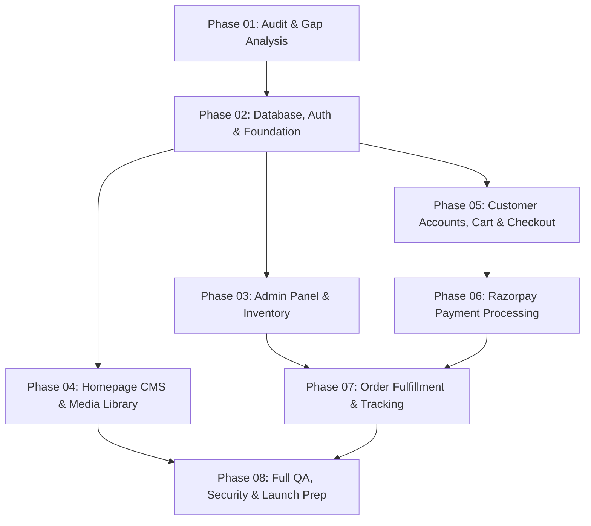

# Pavishna Organic Worlds — Implementation Plan

**Project:** Pavishna Organic Worlds  
**Architecture:** Next.js 16 (App Router) + TypeScript + Tailwind CSS v4 + Prisma ORM + Razorpay  
**Playbook Reference:** `pavishna_organic_worlds_8_phase_ai_agent_playbook.md`  

---

## Phased Master Roadmap

---

## Phase 01: Repository Audit, Feature Gap Analysis, and Roadmap
- **Status:** `VERIFIED_COMPLETE`
- **Scope:** Complete discovery of repository, tech stack, routes, mock vs real features, baseline tests, security findings, admin specifications, and tracking files creation.
- **Dependencies:** None.
- **Acceptance Criteria:**
  - [x] Repository inspected; mock vs real functionality distinguished.
  - [x] Route inventory and workflow audit documented in `docs/PROJECT_AUDIT.md`.
  - [x] Persistent tracking files established (`docs/PROJECT_AUDIT.md`, `docs/IMPLEMENTATION_PLAN.md`, `docs/FEATURE_MATRIX.md`, `docs/PROGRESS.md`, `docs/ENVIRONMENT_SETUP.md`, updated `docs/DECISIONS.md`, and `README.md`).
  - [x] No premature implementation started during Phase 01.

---

## Phase 02: Secure Foundation, Data Model, Authentication, and API Architecture
- **Status:** `NOT_TESTED` (Pending Execution)
- **Scope:**
  - Resolve existing baseline ESLint errors (`SiteHeader.tsx`, `PavishnaBestSellers.tsx`).
  - Install and configure Prisma ORM with SQLite (development/testing) and PostgreSQL compatibility for production.
  - Implement comprehensive Prisma schema: `User`, `Address`, `Category`, `Product`, `ProductVariant`, `Order`, `OrderItem`, `Payment`, `HomepageContent`, `MediaAsset`, `AdminAuditLog`.
  - Execute database migration and write seed script importing the 19 authentic Pavishna products and categories from `src/config/products.ts`.
  - Implement authentication service: password hashing (`bcryptjs`), secure HTTP-only session cookies, JWT token verification, and Next.js middleware guards.
  - Build typed server validation schemas (`zod`) and business service modules for products, inventory, and orders.
  - Unit/integration test foundation scripts.
- **Dependencies:** Phase 01.
- **Acceptance Criteria:**
  - Relational database schema compiles and migrates cleanly.
  - Database seed populates products with correct prices, botanical specs, and variant SKUs.
  - Authentication routes (`/api/auth/login`, `/api/auth/register`, `/api/auth/logout`, `/api/auth/me`) work with HTTP-only cookies.
  - Server-side role checks reject non-admin access to protected APIs.
  - TypeScript compiles with 0 errors; ESLint passes with 0 errors.

---

## Phase 03: Complete Admin Panel and Product/Inventory Management
- **Status:** `VERIFIED_COMPLETE`
- **Scope:**
  - Admin layout (`/admin`) with responsive navigation and session verification.
  - Admin dashboard displaying live metrics: order counts by status, revenue, pending payments, out-of-stock and low-stock alerts.
  - Product management: server-side paginated list, search, category filter, create/edit form with botanical specs, variant editor, image management, draft/published toggle.
  - Category management: create, edit, slug generation, ordering, image references.
  - Inventory management: real-time stock levels, low-stock threshold configuration, manual stock adjustments with audit log.
- **Dependencies:** Phase 02.
- **Acceptance Criteria:**
  - Authorized admin can create, update, publish, and archive real products without touching source code.
  - Inventory changes persist and update database records immediately.
  - Unauthorized users are redirected away from `/admin` to `/admin/login`.

---

## Phase 04: Homepage CMS, Hero Editor, and Media Library
- **Status:** `VERIFIED_COMPLETE`
- **Scope:**
  - Homepage CMS editor in Admin (`/admin/homepage`): edit announcement bar text, hero title, subtitle, CTA destination links, and toggle section visibility.
  - Hero visual editor: select or upload hero desktop & mobile imagery, configure image overlay and focal positioning.
  - Media Library (`/admin/media`): file upload endpoint with MIME-type and size validation, media browser, alt text editor, and image replacement.
  - Storefront dynamic loading: update `src/app/page.tsx` to read dynamic CMS configuration with fallback to defaults, supporting Next.js on-demand revalidation.
- **Dependencies:** Phase 02, Phase 03.
- **Acceptance Criteria:**
  - Admin changes to hero headline or announcement bar render immediately on storefront upon saving.
  - Media upload persists files safely and generates valid URLs.
  - No temporary `blob:` or mock URLs are stored in the database.

---

## Phase 05: Customer Accounts, Product Discovery, Cart, and Checkout
- **Status:** `VERIFIED_COMPLETE`
- **Scope:**
  - Migrate storefront catalog (`/shop`, `/categories`, `/products/[slug]`) to read from the database layer rather than static mock arrays.
  - Customer account interface (`/account`, `/account/orders`, `/account/addresses`): login, registration, profile update, saved addresses, and order history.
  - Authoritative Cart: recalculate subtotal, taxes, and shipping on the server; reject stale prices or out-of-stock items.
  - Real Checkout Flow (`/cart` & `/checkout`): delivery address collection, coupon validation, server-calculated grand total, and atomic order creation in `PENDING_PAYMENT` state.
- **Dependencies:** Phase 02, Phase 03.
- **Acceptance Criteria:**
  - Customer can register, log in, manage addresses, and view personal orders.
  - Client cannot manipulate product prices or order totals.
  - Submitting checkout creates a real persisted `Order` and `OrderItem` records in the database.

---

## Phase 06: Secure Payment Integration (Razorpay First, Stripe Optional)
- **Status:** `VERIFIED_COMPLETE`
- **Scope:**
  - Integrate Razorpay Node.js SDK for India e-commerce (INR ₹ transactions, UPI, Netbanking, Cards).
  - Server-side payment intent/order creation (`/api/checkout/razorpay/create-order`).
  - Client-side checkout modal handoff via Razorpay Standard Checkout SDK.
  - Server-side HMAC-SHA256 signature verification (`/api/checkout/razorpay/verify`).
  - Webhook handler (`/api/webhooks/razorpay`) verifying raw request body signature, handling asynchronous events (`payment.captured`, `payment.failed`), with duplicate event idempotency protection.
  - Order status advancement to `CONFIRMED` upon verified payment receipt.
- **Dependencies:** Phase 05.
- **Acceptance Criteria:**
  - Payment records reflect truthful provider status.
  - Tampered signatures or incorrect amounts are rejected immediately.
  - Webhooks handle replay and out-of-order events gracefully without duplicate state updates.

---

## Phase 07: Order Administration, Fulfilment, Delivery Tracking, and Notifications
- **Status:** `VERIFIED_COMPLETE`
- **Scope:**
  - Admin order management workspace (`/admin/orders`, `/admin/orders/[id]`): filter by status/date, search by order number/customer name.
  - Order state machine transitions (`CONFIRMED` -> `PROCESSING` -> `SHIPPED` -> `DELIVERED` / `CANCELLED`).
  - Fulfilment tracking: record carrier (Delhivery, BlueDart, India Post), AWB tracking number, and tracking URL.
  - Customer tracking interface: secure lookup using unguessable token (`/track/[token]`).
  - Transactional notification abstraction (order confirmation, dispatch, delivery) with logging.
- **Dependencies:** Phase 03, Phase 06.
- **Acceptance Criteria:**
  - Admin can update order fulfilment status and assign tracking numbers.
  - Customer tracking page reflects accurate real-time order history.
  - Status transitions follow strict state machine rules and preserve audit history.

---

## Phase 08: Full QA, Security Review, Production Readiness, and Final Documentation
- **Status:** `VERIFIED_COMPLETE`
- **Scope:**
  - End-to-end automated testing suite covering auth, cart recalculation, order creation, payment verification, and admin operations.
  - Full route and responsive verification across desktop, tablet, and mobile viewports.
  - Security hardening: input validation, rate limiting, SQL injection defense, CSRF defense, and secret scrubbing.
  - Production build verification (`npm run build`).
  - Reconciliation of all Markdown documentation (`README.md`, `docs/*`).
- **Dependencies:** Phases 01 through 07.
- **Acceptance Criteria:**
  - All automated tests, linter, and production build pass with 0 errors.
  - Release readiness evaluation: `READY_FOR_REVIEW`.
